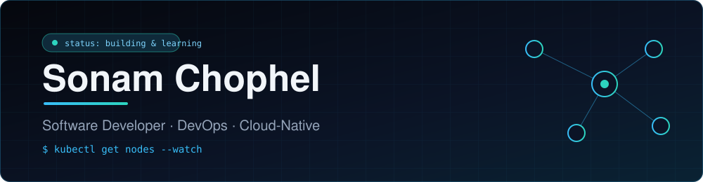

 

## `> whoami`

Hi, I'm **Sonam Chophel**. I work in digital technology, building and maintaining real-world digital services, including government-facing systems.

My day-to-day covers application development, enhancements, testing, containerization, deployment and vulnerability scanning. I'm now going deeper into **DevOps and cloud-native engineering**: learning Kubernetes and container orchestration, automating pipelines, and building security checks into CI/CD.

I learn by building, so most of what's listed here comes from something I've actually deployed, broken and fixed.

 

## `> tech --stack`

**DevOps & Infrastructure**

`CI/CD` · `Container Orchestration` · `Pipeline Automation`

 

**Security & DevSecOps**

`SBOM` · `Vulnerability Assessment` · `Application Security`

 

**Development**

 

**Databases & Tools**

 

## `> ls projects/`

Much of my professional work is on internal or government systems, so the source is **not public** and I don't publish internal details. The summaries below describe the type of work only.

| Project | What it is | Stack | Link |
| :-- | :-- | :-- | :-- |
| **MRMS** — Media Request Management System | Manages media requests, workflows, institutional coordination and approvals. |   | Private |
| **Fuel Distribution Management System** | Supports fuel distribution processes, outlet management and digital operational workflows. |   | Private |
| **NFDMS** | Application development, system enhancement, deployment and technical maintenance. |   | Private |
| **DevOps & CI/CD** | Docker builds, automated pipelines, code-quality checks, security and container scans, deployment workflows. |    | [docker-deplo](https://github.com/SonamShark/docker-deplo) (public demo) |
| **Kubernetes Learning Lab** | Hands-on lab: clusters, nodes, deployments, pods, services, namespaces and cluster administration. |   | Notes coming soon |

### Public repositories

| Repository | Description |
| :-- | :-- |
| [url-shortener-fullstack](https://github.com/SonamShark/url-shortener-fullstack) | Full-stack URL shortener (JavaScript). |
| [docker-deplo](https://github.com/SonamShark/docker-deplo) | Fork used to practice Docker build, test and deploy with CI/CD. |
| [govwebsite](https://github.com/SonamShark/govwebsite) | Government-style website (TypeScript). |
| [travel-website](https://github.com/SonamShark/travel-website) | Travel website front end (JavaScript). |
| [backend](https://github.com/SonamShark/backend) | Backend learning projects. |

 

## `> currently --learning`

Areas I'm exploring and practicing, not claiming mastery of:

- **Kubernetes** — cluster administration and multi-node architecture
- **Container orchestration** — workloads, services, namespaces
- **DevSecOps** — security scanning in every pipeline stage
- **CI/CD & infrastructure automation**
- **Cloud-native architecture**
- **Application & container security**
- **Observability and monitoring**

 

## `> stats`

  

> Stats reflect public activity only. Most of my professional work lives in private repositories.

 

## `> contact`

<!-- Replace each placeholder below with your real link, then remove the comment. -->

  

Always learning, always shipping.

